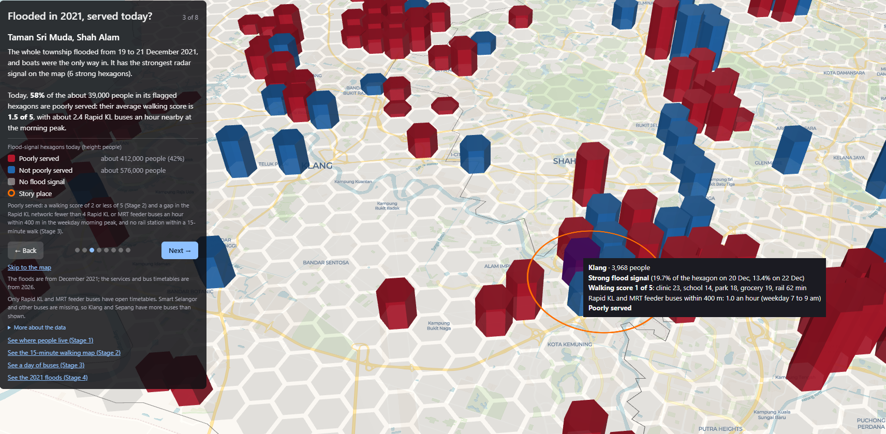

# Klang Valley Reach and Risk

Interactive maps of where people live in Malaysia's Klang Valley, which everyday services they can reach on foot, how often buses pass near them, where radar satellites saw the December 2021 floods, and how well served the flooded areas are today, built on a hexagon grid with Python, H3, pydeck and deck.gl.

**Live maps**

- **Start here, the story:** https://likrentai.github.io/klreach/story.html (flooded in 2021, served today?)
- 15-minute walking map: https://likrentai.github.io/klreach/
- Where people live: https://likrentai.github.io/klreach/population.html
- A day of buses: https://likrentai.github.io/klreach/buses.html
- The 2021 floods: https://likrentai.github.io/klreach/floods.html

*Stage 5: flooded in 2021, served today? A guided story in eight steps, ending in a map to explore.*

*Stage 4: where did radar see the 2021 floods? Orange circles are places reported flooded by news and Wikipedia.*

*Stage 3: every Rapid KL and MRT feeder bus through a weekday, from the published timetables.*

*Stage 2: can you walk to everyday needs? Hover over (or tap) a hexagon to see the walking minutes to each service.*

*Stage 1: where the Klang Valley lives.*

## What the maps show

The Klang Valley (Kuala Lumpur, Putrajaya and the Selangor districts of Petaling, Gombak, Ulu Langat, Klang and Sepang) is divided into about 4,000 hexagons of about 0.74 km² each (H3 resolution 8).

- **Stage 1, where people live:** column height and colour show the number of people in each hexagon.
- **Stage 2, the 15-minute walk:** for every hexagon, the walking time along real streets and footpaths to the nearest clinic or hospital, school, park or playground, grocery and rail station. The colour shows how many of these five are within a 15-minute walk; the height still shows population. Hover over a hexagon to see the minutes to each service.
- **Stage 3, a day of buses:** two views. *Watch the buses* animates every Rapid KL and MRT feeder bus through a weekday or a weekend day, with a clock, play and pause, speed, a time slider and a small graph of buses on the road. *Buses per hour* colours each hexagon by the buses an hour stopping within 400 m (morning peak 7 to 9 am, or all-day average), with height showing population; a checkbox shows only the gaps in the Rapid KL network.
- **Stage 4, the 2021 floods:** hexagon colour shows where the Sentinel-1 radar images of 20 and 22 December 2021 show a flood signal: *strong* (both days), *possible* (one day) or none; height shows population. Orange circles mark places reported flooded in news reports, and their tooltips show what the radar saw there. This is a radar signal, a minimum, not a complete flood map (see Limitations).
- **Stage 5, the story:** a guided page in eight steps that joins Stages 2 to 4. Each step moves the camera and changes the map: the valley's population, the 2021 flood signal, Taman Sri Muda, Meru and Bukit Raja, Dengkil and Salak Tinggi, central Kuala Lumpur as the contrast, the overall answer, and a free map to explore. Flood-signal hexagons are coloured by whether the people there are *poorly served* today (see Method).

On phones and tablets, the maps open flat (seen from above) and lighter, so they load smoothly; the 3D view and the bus animation are for computers. On phones the bus page shows buses per hour only. The flood page opens flat on phones, like the walking map. On phones the story map is flat and the story panel sits at the bottom of the screen.

## Key findings (Stage 2)

Share of the Klang Valley's 8.3 million people (Kontur estimate) within a 15-minute walk:

| Service | Share of people |
|---|---|
| Grocery | 66% |
| Park or playground | 66% |
| School | 57% |
| Clinic or hospital | 47% |
| Rail station | 18% |

- About **10%** of people can reach all five services within 15 minutes; about **16%** can reach none.
- Kuala Lumpur scores highest (on average 3.5 of 5 services), followed by Petaling (2.6) and Ulu Langat (2.5); Klang (1.7) and Sepang (1.4) score lowest.
- Rail is the scarcest service on foot: 34% of people in Kuala Lumpur live within 15 minutes' walk of a station, but only 5% in Gombak and 7% in Klang.

## Key findings (Stage 3)

Rapid KL and MRT feeder buses only (see Limitations). On the sample weekday, 9,241 bus runs operate, with up to 582 buses on the road at once (07:30); on the sample Saturday, 7,449 runs and up to 429 (08:00).

Share of people by buses an hour stopping within 400 m, weekday morning peak (7 to 9 am):

| Buses an hour | Share of people |
|---|---|
| None | 41% |
| Under 2 | 8% |
| 2 to 4 | 21% |
| 4 to 8 | 16% |
| 8 to 15 | 8% |
| 15 or more | 6% |

- Only about **14%** of people have 8 or more of these buses an hour nearby in the morning peak.
- Average buses an hour near where people live (weekday peak): Kuala Lumpur 6.7, Ulu Langat 4.7, Petaling 3.4, Putrajaya 3.0, Gombak 2.5, Sepang 0.5, Klang 0.4.
- About **62%** of people live in a gap in the Rapid KL network: fewer than 4 of these buses an hour within 400 m in the weekday morning peak and no rail station within a 15-minute walk. This is 36% in Kuala Lumpur but over 90% in Klang and Sepang, where other operators (not in the open data) run most buses.

## Key findings (Stage 4)

The images are from 20 December (evening) and 22 December 2021 (morning), two to four days after the flood peak (around 18 December).

- Radar flagged **213 of 4,003 hexagons**, where about **988,000 people** live (12% of the Klang Valley). Not every flagged hexagon was flooded, and some flooded places are missed.
- **Strong signal (both days): 18 hexagons, about 47,000 people.** They cluster at Taman Sri Muda (Shah Alam), around Meru in Klang, and at Dengkil and Salak Tinggi in Sepang, all places reported flooded.
- **Possible signal (one day): 195 hexagons, about 941,000 people**, but 178 of them come from the 22 December image alone, so no second image confirms them.
- At Taman Sri Muda, where the whole township flooded on 19 to 21 December, radar flags 20% to 26% of the hexagon, against 1% on a dry day. In central Kuala Lumpur, reported flooded around 18 December, radar flags only 0.5% to 2.5%: radar misses water between tall buildings.
- Control test: the same method applied to two dry days in early December flagged 30 hexagons as possible and none as strong, against 213 and 18 on the flood days.

## Key findings (Stage 5)

*Poorly served* means a walking score of 2 or less of 5 (Stage 2) **and** a gap in the Rapid KL network (Stage 3). The floods are from 2021; the services and timetables are from 2026.

| People living in | Poorly served today |
|---|---|
| Strong flood-signal hexagons (18; about 47,000 people) | **69%** |
| Possible flood-signal hexagons (195; about 941,000 people) | 40% |
| All flood-signal hexagons (213; about 988,000 people) | 42% |
| The whole Klang Valley (8.3 million people) | 39% |

- Where the flood signal is strongest, the places most surely flooded, people are much more often poorly served (69%) than across the valley (39%).
- Klang stands out: **81%** of the people in its flood-signal hexagons are poorly served, against 6% in Kuala Lumpur's. Around Meru and Bukit Raja it is 92%, with an average walking score of 1.0 of 5 and almost no Rapid KL buses at the morning peak (Smart Selangor buses also run there but are not in the open data).
- At Taman Sri Muda, 58% of the people in the flagged hexagons are poorly served (average walking score 1.5 of 5).
- Central Kuala Lumpur was reported flooded but radar flags almost nothing there; the people within 2 km have an average walking score of 4.4 of 5 and about 17 buses an hour nearby.
- The possible tier includes well-served flooded parts of Kuala Lumpur, which is why all flood-signal hexagons together (42%) are close to the valley average.

## Method

1. **Grid and population:** H3 hexagons over the seven districts, filled with Kontur Population (2023-11-01), which is published on the same H3 grid.
2. **Services:** OpenStreetMap features downloaded with OSMnx in small tiles from several Overpass servers. Parks are represented by points every 100 m along their edges, since people enter from the nearest side. Convenience stores (7-Eleven, KK Super Mart, myNEWS and similar) are not counted as groceries; supermarkets including 99 Speedmart, markets and greengrocers are. Rail stations are the Rapid Rail and KTM Komuter stations from my earlier project, [Klang Valley Rail Activity Map](https://likrentai.github.io/klmobility/).
3. **Walking network:** all walkable streets and paths (about 38,700 km) read with pyosmium from the Geofabrik extract for Malaysia, Singapore and Brunei, OpenStreetMap data as of 6 October 2026. Motorways and private roads are excluded; one-way rules are ignored for walking.
4. **Walking times:** the network is stored as a sparse matrix, and one multi-source Dijkstra search per service type (SciPy) gives every street point its distance to the nearest service. Hexagon centres and services are joined to their nearest street point. Walking speed 4.8 km/h, so 15 minutes is 1.2 km.
5. **Bus timetables:** the Prasarana GTFS feeds for Rapid KL buses and MRT feeder buses, for a sample weekday (14 October 2026) and Saturday (17 October 2026). Rapid KL timetables given as "every N minutes" are expanded into individual runs. Stops are placed in order along each route shape, and every run is turned into a path with a time at each point for the animation (deck.gl TripsLayer). A few routes with impossible timetable times are timed at 20 km/h.
6. **Buses per hour:** for each hexagon, all stops within 400 m (straight line) of its centre; each bus run is counted once per hexagon, at its first nearby stop, so a bus passing several nearby stops is not counted twice. Both directions count.
7. **Bus page:** written directly in deck.gl (JavaScript), because saved pydeck pages cannot animate. The page loads its data from small JSON files in `docs/data`.
8. **Flood signal (Stage 4):** Sentinel-1 radar images (Copernicus, via Google Earth Engine) from 20 and 22 December 2021, each compared with the median of dry-weather images (10 November to 13 December) from the same satellite track, so the viewing angle is the same. Two rules, both on land that is low, flat and not permanent water (JRC Global Surface Water, MERIT Hydro height above nearest drainage under 15 m, slope under 5 degrees): *open water* (much darker than on dry days) and *flooded built-up areas* (at least 3 dB brighter than on dry days, in ESA WorldCover built-up land, because water between buildings reflects radar back). Specks under 8 pixels are removed. A first version using only dark water found almost nothing; the built-up rule came from checking known flooded places.
9. **Flood tiers:** the share of each hexagon flagged on each day. *Strong* means at least 5% on both days; *possible* means at least 5% on one day. The cut-off is low because even in streets known to be flooded radar flags only part of a hexagon.
10. **Dry-day control:** the identical method on two dry days (8 and 9 December), used to choose the cut-off and to report how often a dry day looks flooded.
11. **Joining the Stages (Stage 5):** the flood tiers, walking scores and buses per hour are joined on the hexagon code. A hexagon's people are *poorly served* when its walking score is 2 or less **and** it is a gap in the Rapid KL network (fewer than 4 Rapid KL or MRT feeder buses an hour within 400 m in the weekday morning peak, and no rail station within a 15-minute walk). Numbers for the story places count the flagged hexagons whose centre lies within a circle around each place (2 to 5 km).
12. **Story page:** written directly in deck.gl, like the bus page, because pydeck cannot move the camera from step to step. All data is inside the page.

## Limitations

- **OpenStreetMap is incomplete.** Private clinics in particular are better mapped in Kuala Lumpur than in Gombak or Klang, so some low healthcare scores outside Kuala Lumpur reflect missing map data rather than missing clinics.
- **Kontur underestimates Putrajaya's population** (about 8,600 people against about 110,000 in the 2020 census).
- **One point per hexagon:** each hexagon is measured from its centre, so people at its edge may be a few minutes closer or farther.
- **Walking only (Stage 2):** the walking map does not include buses, cars or the quality of footpaths (shade, crossings, pavements).
- **Prasarana buses only (Stage 3):** Rapid KL and MRT feeder buses are the only open bus timetables for the Klang Valley. Smart Selangor's free buses and other operators are missing, so places such as Klang and Sepang have more buses than shown. This is why the map speaks of gaps in the Rapid KL network, not of places without buses.
- **Approximate bus times:** most Rapid KL routes are published as "about every N minutes", so the animation shows a typical day from the timetable, not real bus positions; traffic and delays are not included.
- **A radar signal, not a flood map (Stage 4):** the images came two to four days after the peak, when some water had drained. Radar misses water between tall buildings and under trees, so the map is a minimum and city centres are under-reported.
- **Possible signal is weaker:** 178 of the 195 possible hexagons come from the 22 December image alone. The dry-day control shows they are not random noise, but wet ground after heavy rain could also brighten built-up areas.
- **Reported places are hand-collected:** the four orange circles come from news reports and Wikipedia, with approximate positions, and are not a complete list. Floods outside the Klang Valley hexagon area are not covered.
- **Different years (Stage 5):** the floods are from December 2021, while the services, footpaths and timetables are from 2026. The story asks how well served the flooded areas are *today*, not how well served they were during the flood.
- **Poorly served depends on the bus data (Stage 5):** in Klang and Sepang, part of the "poorly served" result comes from missing Smart Selangor and other buses, so the real situation there is somewhat better than shown.
- **Inherited limits:** Stage 5 carries the limits of Stages 2 to 4, in particular that the flood signal is a minimum and that the possible tier is unconfirmed.
- **400 m is a straight line:** the real walk to a stop is usually longer (about 1.7 times the straight line in Stage 2).

## Data sources and licences

- OpenStreetMap contributors, ODbL 1.0 (services and walking network), via Overpass and Geofabrik
- Kontur Population, 2023-11-01, CC BY 4.0
- Rapid Rail and KTM Komuter station locations, as prepared for the klmobility project
- Prasarana GTFS Static (Rapid KL bus and MRT feeder bus) via data.gov.my, CC BY 4.0
- Copernicus Sentinel-1 radar images (ESA, 2021) via Google Earth Engine
- JRC Global Surface Water; MERIT Hydro (CC BY-NC 4.0); Copernicus DEM GLO-30; ESA WorldCover 2021 (CC BY 4.0)
- Reported flooded places: Malay Mail, Wikipedia (2021 Malaysian floods and place pages), GeoNames
- Basemap: CARTO, OpenStreetMap contributors

## Notebooks (run in this order)

| Notebook | What it does |
|---|---|
| 01hexgrid | Builds the H3 grid and adds Kontur population |
| 02buildmap | Stage 1 map: population in 3D |
| 03services | Downloads the five service types from OpenStreetMap |
| 04walknetwork | Reads the walking network from the Geofabrik file |
| 05access | Walking minutes, 15-minute score and summaries |
| 06buildaccess | Stage 2 map, and both pages in `docs/` for GitHub Pages |
| 07busdata | Reads the bus timetables: routes as paths with times, runs for a weekday and a weekend day |
| 08busaccess | Buses per hour within 400 m of each hexagon, and the gaps in the Rapid KL network |
| 09buildbuses | Stage 3 page (`docs/buses.html`) and its data files in `docs/data` |
| 10eecheck | Checks the Earth Engine login and the radar images for 20 and 22 December 2021 |
| 11floodextract | Flags flooded pixels on the two flood days and two dry control days, adds them up per hexagon, and sets the cut-off |
| 12floodcheck | Diagnostic: radar change at known flooded places and candidate rules, flood days against dry days |
| 13buildfloods | Stage 4 page (`docs/floods.html`) and links to it from the other pages |
| 14combine | Joins Stages 2 to 4, marks who is poorly served, and counts people by flood tier, district and story place |
| 15buildstory | Stage 5 story page (`docs/story.html`) and links to it from the other pages |

## Refreshing the bus data (Stage 3)

The bus page is a snapshot of the two sample days shown in its credit line, so it stays correct for that week even after the timetable files expire. Prasarana publishes new files every month or two (the MRT feeder file covers about six weeks; the Rapid KL file runs longer). A refresh is worth doing when the network changes noticeably (for example a new rail line with its feeder buses), when current figures are needed, or about once a year.

1. Download both GTFS files again from data.gov.my into `data/raw`, keeping the same names: `gtfs_rapidbus_kl.zip` (https://api.data.gov.my/gtfs-static/prasarana?category=rapid-bus-kl) and `gtfs_rapidbus_mrtfeeder.zip` (https://api.data.gov.my/gtfs-static/prasarana?category=rapid-bus-mrtfeeder).
2. In `07busdata`, Section 0, set `DAYS` to a weekday and a Saturday that fall inside the valid dates of both new files (07 prints which services run on each day; if one feed shows no services, pick other dates).
3. Run `07busdata`, `08busaccess` and `09buildbuses` in this order.
4. Upload `docs/buses.html` and the five files in `docs/data` to GitHub. The new sample dates appear on the page automatically.
5. Update "Key findings (Stage 3)" in this README from `data/processed/bus_summary.json`.

Built with Python (pandas, GeoPandas, H3, pydeck, OSMnx, pyosmium, SciPy, Google Earth Engine) and, for the bus and story pages, deck.gl and MapLibre in JavaScript.

Lik Ren Tai, 2026
