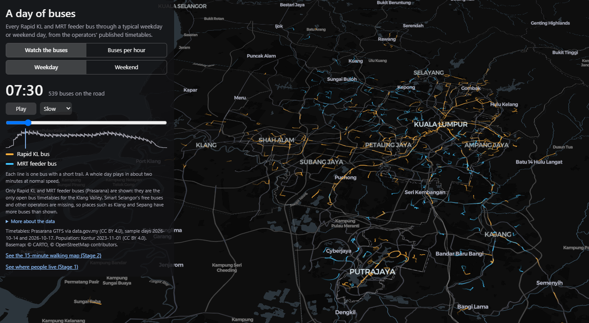
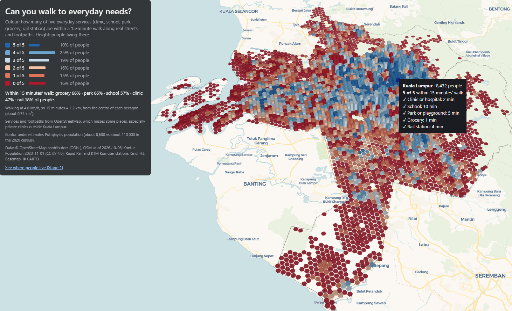
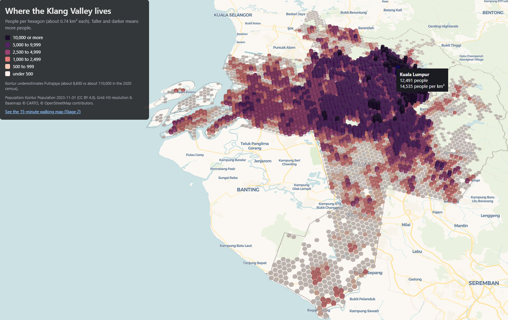

# Klang Valley Reach and Risk

Interactive maps of where people live in Malaysia's Klang Valley, which everyday services they can reach on foot, and how often buses pass near them, built on a hexagon grid with Python, H3, pydeck and deck.gl.

**Live maps**

- 15-minute walking map: https://likrentai.github.io/klreach/
- Where people live: https://likrentai.github.io/klreach/population.html
- A day of buses: https://likrentai.github.io/klreach/buses.html

*Stage 3: every Rapid KL and MRT feeder bus through a weekday, from the published timetables.*

*Stage 2: can you walk to everyday needs? Hover over (or tap) a hexagon to see the walking minutes to each service.*

*Stage 1: where the Klang Valley lives.*

## What the maps show

The Klang Valley (Kuala Lumpur, Putrajaya and the Selangor districts of Petaling, Gombak, Ulu Langat, Klang and Sepang) is divided into about 4,000 hexagons of about 0.74 km² each (H3 resolution 8).

- **Stage 1, where people live:** column height and colour show the number of people in each hexagon.
- **Stage 2, the 15-minute walk:** for every hexagon, the walking time along real streets and footpaths to the nearest clinic or hospital, school, park or playground, grocery and rail station. The colour shows how many of these five are within a 15-minute walk; the height still shows population. Hover over a hexagon to see the minutes to each service.
- **Stage 3, a day of buses:** two views. *Watch the buses* animates every Rapid KL and MRT feeder bus through a weekday or a weekend day, with a clock, play and pause, speed, a time slider and a small graph of buses on the road. *Buses per hour* colours each hexagon by the buses an hour stopping within 400 m (morning peak 7 to 9 am, or all-day average), with height showing population; a checkbox shows only the gaps in the Rapid KL network.

On phones and tablets, the maps open flat (seen from above) and lighter, so they load smoothly; the 3D view and the bus animation are for computers. On phones the bus page shows buses per hour only.

## Key findings (Stage 2)

Share of the Klang Valley's 8.3 million people (Kontur estimate) within a 15-minute walk:

| Service | Share of people |
|---|---|
| Grocery | 66% |
| Park or playground | 66% |
| School | 57% |
| Clinic or hospital | 47% |
| Rail station | 18% |

- About **10%** of people can reach all five services within 15 minutes; about **16%** can reach none.
- Kuala Lumpur scores highest (on average 3.5 of 5 services), followed by Petaling (2.6) and Ulu Langat (2.5); Klang (1.7) and Sepang (1.4) score lowest.
- Rail is the scarcest service on foot: 34% of people in Kuala Lumpur live within 15 minutes' walk of a station, but only 5% in Gombak and 7% in Klang.

## Key findings (Stage 3)

Rapid KL and MRT feeder buses only (see Limitations). On the sample weekday, 9,241 bus runs operate, with up to 582 buses on the road at once (07:30); on the sample Saturday, 7,449 runs and up to 429 (08:00).

Share of people by buses an hour stopping within 400 m, weekday morning peak (7 to 9 am):

| Buses an hour | Share of people |
|---|---|
| None | 41% |
| Under 2 | 8% |
| 2 to 4 | 21% |
| 4 to 8 | 16% |
| 8 to 15 | 8% |
| 15 or more | 6% |

- Only about **14%** of people have 8 or more of these buses an hour nearby in the morning peak.
- Average buses an hour near where people live (weekday peak): Kuala Lumpur 6.7, Ulu Langat 4.7, Petaling 3.4, Putrajaya 3.0, Gombak 2.5, Sepang 0.5, Klang 0.4.
- About **62%** of people live in a gap in the Rapid KL network: fewer than 4 of these buses an hour within 400 m in the weekday morning peak and no rail station within a 15-minute walk. This is 36% in Kuala Lumpur but over 90% in Klang and Sepang, where other operators (not in the open data) run most buses.

## Method

1. **Grid and population:** H3 hexagons over the seven districts, filled with Kontur Population (2023-11-01), which is published on the same H3 grid.
2. **Services:** OpenStreetMap features downloaded with OSMnx in small tiles from several Overpass servers. Parks are represented by points every 100 m along their edges, since people enter from the nearest side. Convenience stores (7-Eleven, KK Super Mart, myNEWS and similar) are not counted as groceries; supermarkets including 99 Speedmart, markets and greengrocers are. Rail stations are the Rapid Rail and KTM Komuter stations from my earlier project, [Klang Valley Rail Activity Map](https://likrentai.github.io/klmobility/).
3. **Walking network:** all walkable streets and paths (about 38,700 km) read with pyosmium from the Geofabrik extract for Malaysia, Singapore and Brunei, OpenStreetMap data as of 6 October 2026. Motorways and private roads are excluded; one-way rules are ignored for walking.
4. **Walking times:** the network is stored as a sparse matrix, and one multi-source Dijkstra search per service type (SciPy) gives every street point its distance to the nearest service. Hexagon centres and services are joined to their nearest street point. Walking speed 4.8 km/h, so 15 minutes is 1.2 km.
5. **Bus timetables:** the Prasarana GTFS feeds for Rapid KL buses and MRT feeder buses, for a sample weekday (14 October 2026) and Saturday (17 October 2026). Rapid KL timetables given as "every N minutes" are expanded into individual runs. Stops are placed in order along each route shape, and every run is turned into a path with a time at each point for the animation (deck.gl TripsLayer). A few routes with impossible timetable times are timed at 20 km/h.
6. **Buses per hour:** for each hexagon, all stops within 400 m (straight line) of its centre; each bus run is counted once per hexagon, at its first nearby stop, so a bus passing several nearby stops is not counted twice. Both directions count.
7. **Bus page:** written directly in deck.gl (JavaScript), because saved pydeck pages cannot animate. The page loads its data from small JSON files in `docs/data`.

## Limitations

- **OpenStreetMap is incomplete.** Private clinics in particular are better mapped in Kuala Lumpur than in Gombak or Klang, so some low healthcare scores outside Kuala Lumpur reflect missing map data rather than missing clinics.
- **Kontur underestimates Putrajaya's population** (about 8,600 people against about 110,000 in the 2020 census).
- **One point per hexagon:** each hexagon is measured from its centre, so people at its edge may be a few minutes closer or farther.
- **Walking only (Stage 2):** the walking map does not include buses, cars or the quality of footpaths (shade, crossings, pavements).
- **Prasarana buses only (Stage 3):** Rapid KL and MRT feeder buses are the only open bus timetables for the Klang Valley. Smart Selangor's free buses and other operators are missing, so places such as Klang and Sepang have more buses than shown. This is why the map speaks of gaps in the Rapid KL network, not of places without buses.
- **Approximate bus times:** most Rapid KL routes are published as "about every N minutes", so the animation shows a typical day from the timetable, not real bus positions; traffic and delays are not included.
- **400 m is a straight line:** the real walk to a stop is usually longer (about 1.7 times the straight line in Stage 2).

## Data sources and licences

- OpenStreetMap contributors, ODbL 1.0 (services and walking network), via Overpass and Geofabrik
- Kontur Population, 2023-11-01, CC BY 4.0
- Rapid Rail and KTM Komuter station locations, as prepared for the klmobility project
- Prasarana GTFS Static (Rapid KL bus and MRT feeder bus) via data.gov.my, CC BY 4.0
- Basemap: CARTO, OpenStreetMap contributors

## Notebooks (run in this order)

| Notebook | What it does |
|---|---|
| 01hexgrid | Builds the H3 grid and adds Kontur population |
| 02buildmap | Stage 1 map: population in 3D |
| 03services | Downloads the five service types from OpenStreetMap |
| 04walknetwork | Reads the walking network from the Geofabrik file |
| 05access | Walking minutes, 15-minute score and summaries |
| 06buildaccess | Stage 2 map, and both pages in `docs/` for GitHub Pages |
| 07busdata | Reads the bus timetables: routes as paths with times, runs for a weekday and a weekend day |
| 08busaccess | Buses per hour within 400 m of each hexagon, and the gaps in the Rapid KL network |
| 09buildbuses | Stage 3 page (`docs/buses.html`) and its data files in `docs/data` |

Built with Python (pandas, GeoPandas, H3, pydeck, OSMnx, pyosmium, SciPy) and, for the bus page, deck.gl and MapLibre in JavaScript.

## Coming next

- **Stage 4:** the December 2021 floods, mapped from Sentinel-1 radar images
- **Stage 5:** how well served are the areas that flooded in 2021, today?

Lik Ren Tai, 2026
